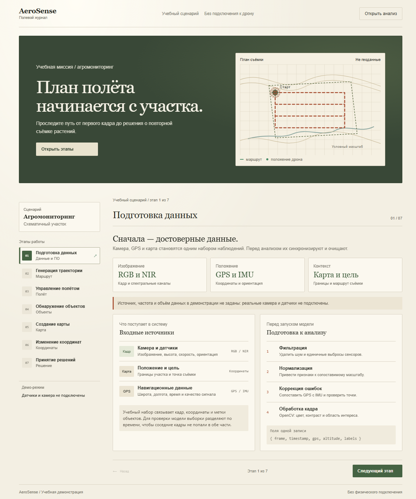
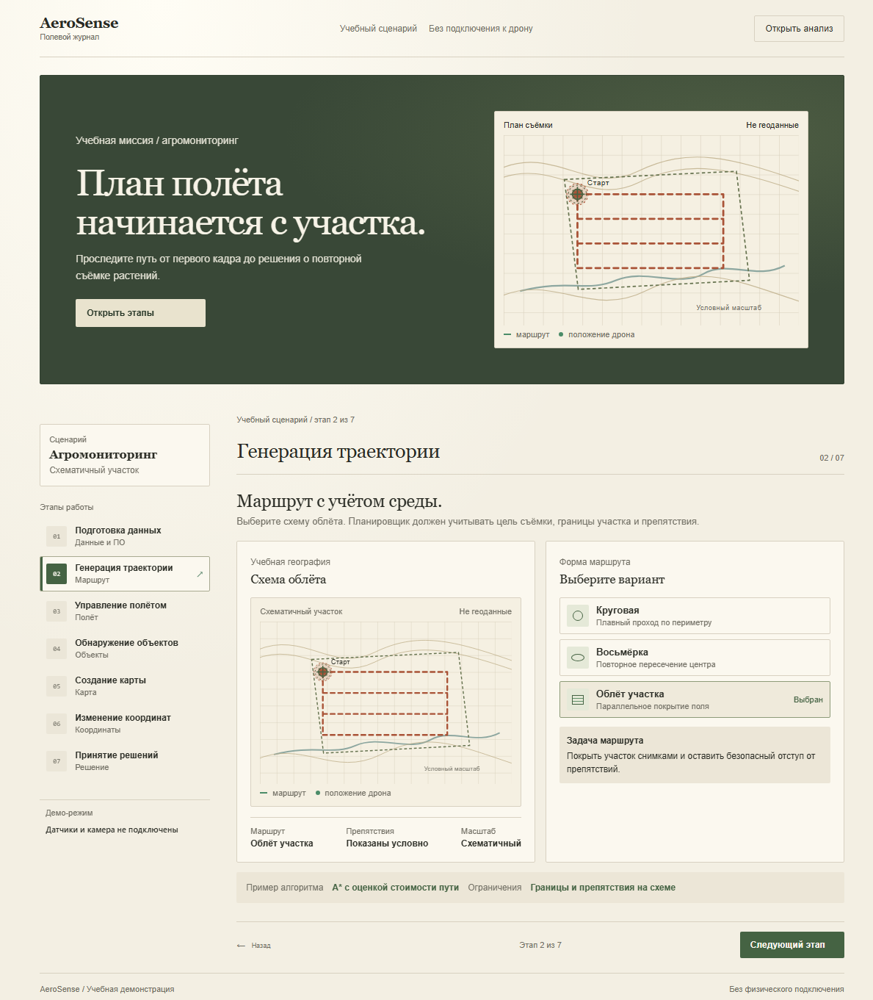
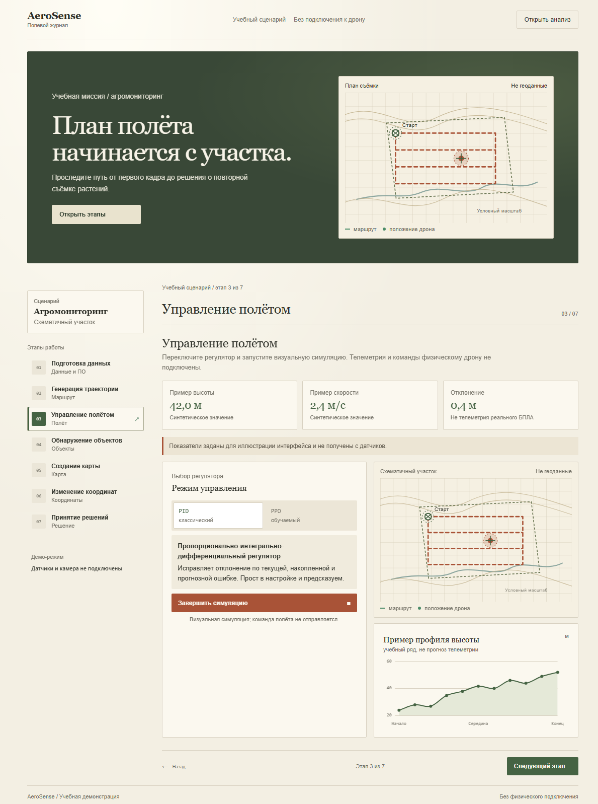
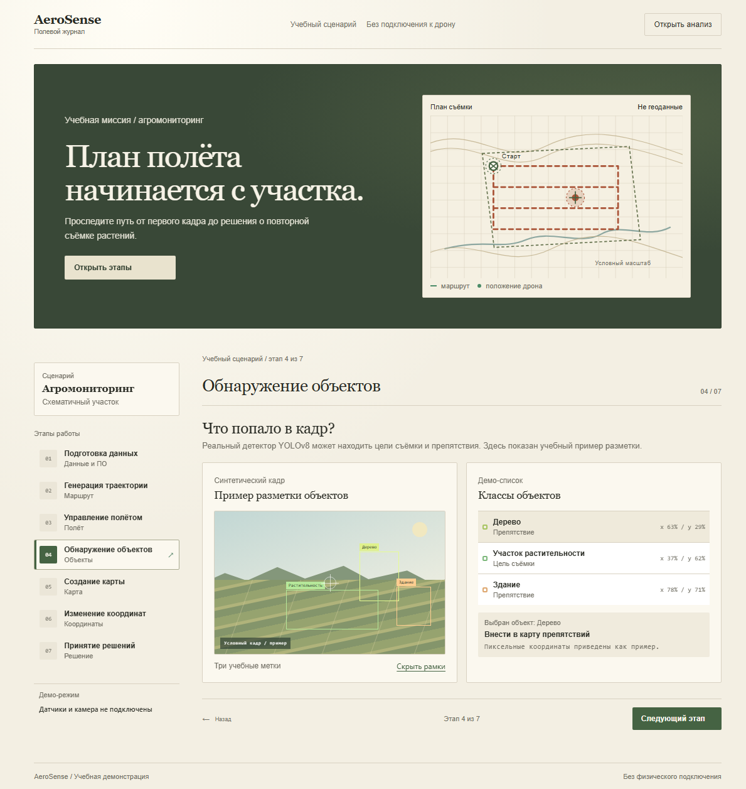
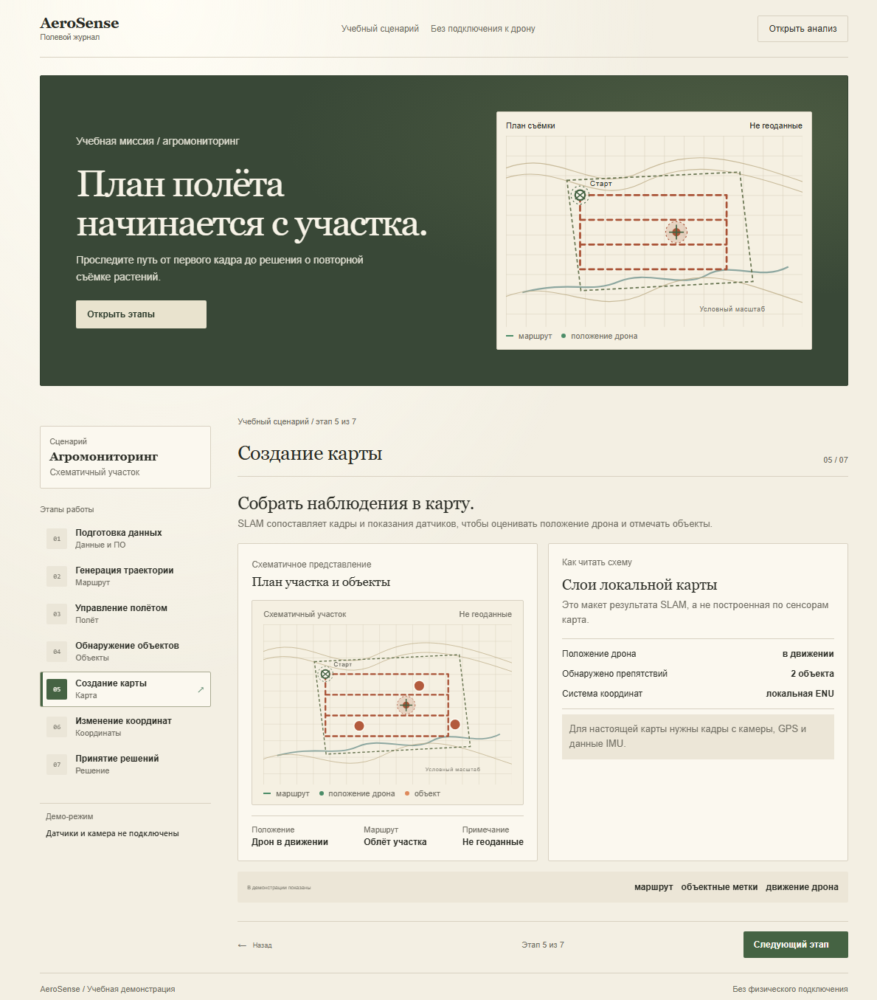
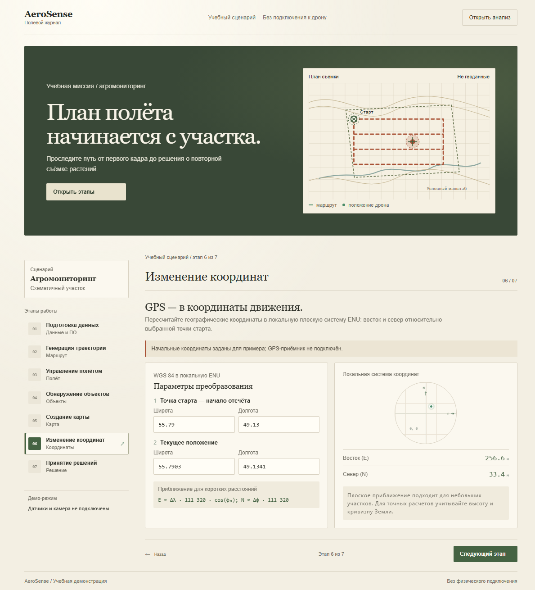
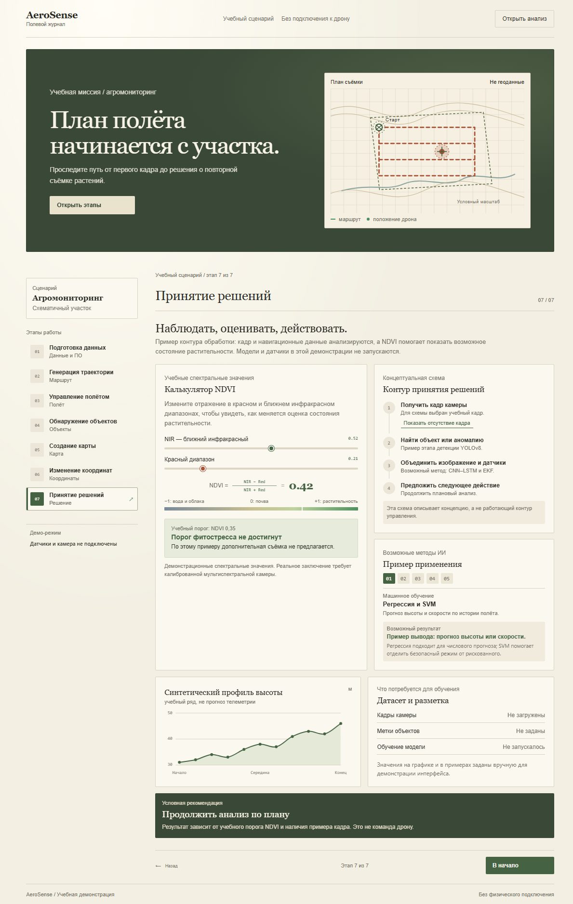
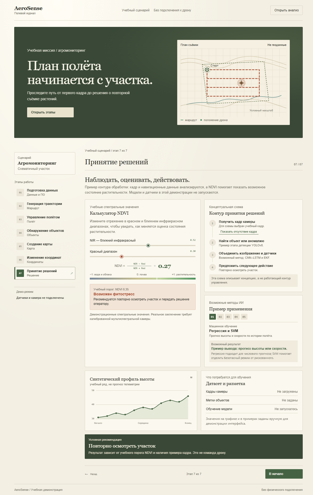

# AeroSense — интеллектуальное управление БПЛА

Учебное React-приложение, показывающее цикл управления дроном: от подготовки данных и планирования маршрута до анализа снимков и принятия решений. Интерфейс разделён на семь этапов.

## Запуск

Требуется Node.js 20 или новее.

```bash
npm install
npm run dev
```

Vite выведет локальный адрес приложения в терминал. Для production-сборки выполните `npm run build`.

## Цель и входные данные

Учебный сценарий показывает, как интеллектуальная система могла бы объединять изображения RGB/NIR, GPS, IMU и сведения об участке. Приложение не подключается к камере, GPS-приёмнику или БПЛА: входные данные и графики демонстрационные, а отдельного backend/API нет. Расчёты выполняются в браузере.

Перед запуском реальной модели данные потребовалось бы синхронизировать, фильтровать от шума, нормализовать и проверять на ошибки. Для изображений в интерфейсе описана возможная предобработка с OpenCV.

## Визуальный стиль

Интерфейс оформлен как полевой журнал: тёплая бумажная основа, чернильный текст, контурная карта и сдержанные зелёный и терракотовый акценты. Демонстрационные данные явно помечены; декоративные индикаторы телеметрии и вымышленные метрики убраны. Вёрстка адаптируется к узкому экрану, интерактивные элементы имеют клавиатурный фокус, а анимация учитывает настройку `prefers-reduced-motion`.

## Семь этапов системы

### 1. Подготовка данных и ПО

Показаны типы данных, которые можно объединить в набор с временными метками: кадры, координаты, показания датчиков и метки объектов. Частота, объём и источник набора не заданы. Для проверки модели выборки следует разделять по времени.



### 2. Генерация траектории

Можно переключать три схематичных маршрута: круговой, «восьмёрку» и параллельный облёт. Схема иллюстрирует цель покрытия участка и отступ от препятствий; поиск пути и расчёт длины не выполняются.



### 3. Управление полётом

Можно выбрать PID или PPO как примеры регуляторов и запустить визуальный сценарий. Переключатель меняет условное положение маркера и демонстрационные показатели; физика полёта и работа регулятора не рассчитываются. Физический дрон не подключён, график построен по вручную заданным значениям.



### 4. Обнаружение объектов

Показан схематичный кадр с тремя учебными метками: дерево, растительность и здание. Можно скрыть рамки и выбрать метку в списке. YOLOv8 в приложении не запускается; координаты внутри кадра приведены только как примеры, уверенность модели не рассчитывается.



### 5. Создание карты

На схематичную 2D-карту нанесены маршрут, условное положение БПЛА и метки объектов. Это макет результата SLAM, а не построенная по кадрам и датчикам карта; покрытие участка не вычисляется.



### 6. Преобразование координат

Поля широты и долготы редактируются, а координаты цели пересчитываются в локальные восточную и северную составляющие ENU относительно точки старта. Начальные значения — пример; используется приближение для коротких расстояний:

`E ≈ Δλ · 111 320 · cos(φ₀)`, `N ≈ Δφ · 111 320`.



### 7. Принятие решений и NDVI

На странице показана концептуальная схема обработки: получение кадра, детекция, объединение данных и выбор следующего действия. Переключатель кадра меняет текст учебного сценария, но запрос камеры не отправляется.

Калькулятор использует формулу `NDVI = (NIR − Red) / (NIR + Red)`. Ползунки меняют условные значения спектральных каналов; при NDVI ниже демонстрационного порога 0,35 интерфейс предлагает повторно осмотреть участок. Это не диагноз и не команда дрону. Например, `NIR = 0,52`, `Red = 0,30` дают `NDVI ≈ 0,27`.





## Примеры методов ИИ и применений

| Метод | Пример задачи |
|---|---|
| Линейная/полиномиальная регрессия, SVM | Прогноз высоты и скорости, оценка режима полёта |
| CNN–LSTM | Анализ последовательности кадров и динамики БПЛА |
| Decision Tree, Random Forest, XGBoost | Классификация участка и выбор параметров |
| Нечёткая логика Мамдани | Оценка неопределённости и риска препятствия |
| CNN–LSTM + EKF | Объединение прогноза модели с GPS/IMU для оценки положения |

Список методов описывает возможные подходы, но не содержит обученных моделей или результатов вычисления метрик. График Chart.js показывает синтетический профиль высоты, а карточка обучения перечисляет данные, которых в демонстрации нет.

## Вывод и ограничения

Приложение демонстрирует последовательность обработки: подготовка данных → планирование → управление → детекция → картирование → преобразование координат → принятие решения. Пользователь может переключать этапы, менять схему маршрута и координаты, запускать безопасный визуальный сценарий и проверять влияние спектральных значений на NDVI.

Карта, кадр, объектные метки, графики и числа — демонстрационные примеры, а не результат работы нейросети или полевого датасета. Для реального анализа нужны датчики, калиброванная мультиспектральная камера, размеченные данные и обученные модели. Расчёт координат использует локальное приближение для небольшого участка.
